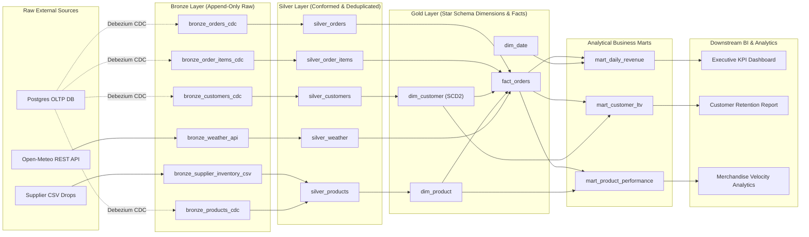

# Data Lineage & Directed Acyclic Graph (DAG)

This document visualizes and describes the complete data lineage of the Medallion Data Platform from source systems to analytical exposures.

---

## 1. End-to-End Lineage Flow

---

## 2. Transformation Logic by Node

1. **`silver_orders`**: Consumes `bronze_orders_cdc`. Deduplicates mutations via `ROW_NUMBER() OVER (PARTITION BY order_id ORDER BY _cdc_ts_ms DESC)`. Filters CDC deletes (`_cdc_op = 'd'`).
2. **`silver_customers`**: Consumes `bronze_customers_cdc`. Trims strings, normalizes emails to lowercase, standardizes loyalty tiers, and prepares historical updates for SCD2 windowing.
3. **`silver_products`**: Joins `bronze_products_cdc` with the latest supplier inventory drop from `bronze_supplier_inventory_csv` to reconcile stock levels and wholesale unit costs.
4. **`silver_weather`**: Cleans weather observations from `bronze_weather_api`, calculates comfort/condition categories (`PLEASANT`, `RAINY`, `HOT`, `COLD`), and deduplicates by `(metric_date, city)`.
5. **`dim_customer`**: Implements Slowly Changing Dimension Type 2 (SCD2). Generates surrogate key `customer_sk = MD5(customer_id || valid_from)`, calculating validity intervals `valid_from` to `valid_to` and `is_current` active flags.
6. **`fact_orders`**: Primary transactional fact table. Enriches order line items with point-in-time SCD2 customer dimensions (`order_timestamp >= valid_from AND order_timestamp < valid_to`) and order-date weather observations.
7. **Business Marts**: Aggregations for daily revenue, customer lifetime value, and SKU performance.
